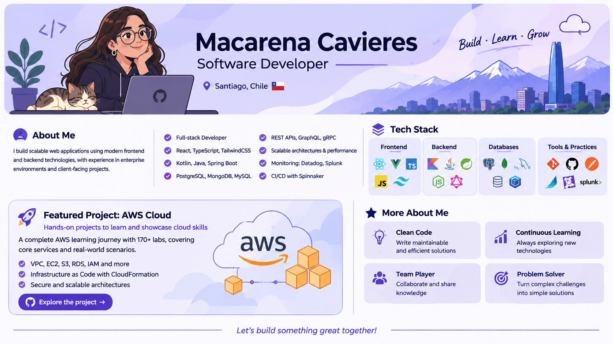

# Macarena Cavieres | Backend Software Developer

  

  <strong>Java · Kotlin · Spring Boot · Microservices</strong>
   
  Backend Engineering | Databases | Cloud AWS
    
  <a href="https://www.linkedin.com/in/macarena-cavieres-rubio/">LinkedIn</a> ·
  <a href="https://github.com/MacarenaCavieres">GitHub</a> ·
  <a href="https://www.youtube.com/@macarena-cavieres">YouTube</a>

## About Me

I'm a Software Developer focused on Backend Engineering, with professional experience building and maintaining applications in enterprise environments.

I work primarily with Java, Kotlin and Spring Boot, developing backend services, integrating APIs and working with relational and NoSQL databases.

I'm interested in software architecture, distributed systems, scalability and building reliable applications.

**My technical focus:**

- Backend development and microservices.
- REST APIs, GraphQL and gRPC.
- SQL and NoSQL databases.
- Software testing and clean architecture.
- Cloud infrastructure and AWS services.

## Technical Expertise

<table>
<tr>
<td width="50%" valign="top">

### Backend Engineering

Java · Kotlin · Spring Boot · Node.js

REST APIs · GraphQL · gRPC · Microservices

</td>
<td width="50%" valign="top">

### Databases

PostgreSQL · MongoDB · MySQL

SQL · NoSQL · Data Modeling

</td>
</tr>
<tr>
<td width="50%" valign="top">

### Cloud & DevOps

AWS · Docker · Linux · Bash

CloudFormation · CI/CD · Spinnaker

</td>
<td width="50%" valign="top">

### Testing & Observability

JUnit · Mockito · JaCoCo

Datadog · Splunk · Postman

</td>
</tr>
</table>

## AWS Lab Showcase

**Learning by building. Documenting by sharing.**

A collection of hands-on AWS implementations from my AWS re/Start training, covering cloud infrastructure, networking, databases, security and automation.

Here are some of the labs I've documented and demonstrated.

<table>
<tr>
<td width="33%" align="center">

**AWS Lab 01**

<a href="https://www.youtube.com/watch?v=pAI1jDF7bvA">▶ Watch demonstration</a>

</td>
<td width="33%" align="center">

**AWS Lab 02**

<a href="https://www.youtube.com/watch?v=bsqoQtlttAI">▶ Watch demonstration</a>

</td>
<td width="33%" align="center">

**AWS Lab 03**

<a href="https://www.youtube.com/watch?v=UnJb_48wr3c">▶ Watch demonstration</a>

</td>
</tr>
</table>

  <a href="https://github.com/MacarenaCavieres/doc-aws-restart">
    <strong>Explore the complete AWS documentation →</strong>
  </a>
   
  <a href="https://www.youtube.com/@macarena-cavieres/videos">
    View all lab demonstrations on YouTube →
  </a>

**What's included in the repository?**

- 18 learning modules and 70+ hands-on labs.
- AWS networking, compute and storage.
- IAM, security and monitoring.
- RDS, MySQL and DynamoDB.
- CloudFormation and Infrastructure as Code.
- Linux, Bash and AWS CLI.
- Python automation for README generation.

## Featured Projects

### Ruta Libre | Clean Architecture

Java application focused on separation of concerns, dependency inversion, test-driven development and maintainable architecture.

**Stack:** Java 21 · Maven · JUnit 5 · Mockito · JaCoCo

[Explore repository →](https://github.com/MacarenaCavieres/ruta-libre-java-course)

### Expedia Clone | Kotlin & Spring Boot

Collaborative travel platform developed by a team of four, integrating backend services, GraphQL, authentication and payment functionality.

**Stack:** Kotlin · Spring Boot · PostgreSQL · GraphQL · React · Redux Toolkit

[Explore backend →](https://github.com/MacarenaCavieres/expedia-clon-softserve-backend)

## Professional Experience

**Software Developer | SoftServe**

Enterprise travel and hospitality project.

- Backend development using Kotlin, Java and Spring Boot.
- Microservices for messaging, conversations and notifications.
- MongoDB persistence.
- Application monitoring with Datadog and Splunk.
- AWS deployment workflows using Spinnaker.
- Collaboration with international development teams.

**Software Developer | Digital Bank**

Digital banking application.

- Development of a mass payments management module.
- Vue.js, TypeScript and Vuetify.
- Backend API integration.
- Agile development and cross-functional collaboration.

## Currently Learning

- AWS Cloud Architecture and infrastructure services.
- Backend engineering with Java and Spring Boot.
- Distributed systems and microservices.
- Infrastructure as Code and deployment automation.
- Software quality and automated testing.

---

  <strong>Let's build something great together.</strong>
    
  <a href="https://www.linkedin.com/in/macarena-cavieres-rubio/">LinkedIn</a> ·
  <a href="https://github.com/MacarenaCavieres">GitHub</a> ·
  <a href="https://www.youtube.com/@macarena-cavieres">YouTube</a>
    
  <em>Build with purpose. Learn continuously.</em>

