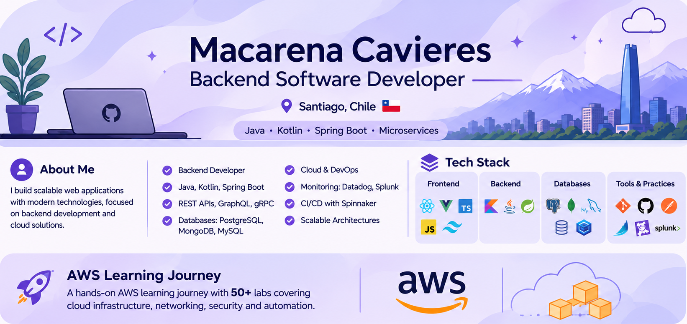

# Macarena Cavieres | Backend Software Developer

  

  <strong>Java · Kotlin · Spring Boot · Microservices</strong>
   
  Backend Engineering | Databases | Cloud AWS
    
  <a href="https://www.linkedin.com/in/macarena-cavieres-rubio/">LinkedIn</a> ·
  <a href="https://github.com/MacarenaCavieres">GitHub</a> ·
  <a href="https://www.youtube.com/@macarena-cavieres">YouTube</a>

---

## 👩‍💻 About Me

I'm a Software Developer focused on **Backend Engineering**, with professional experience developing and maintaining applications in enterprise environments.

My main technologies are **Java, Kotlin and Spring Boot**, working with microservices, API integrations, relational and NoSQL databases.

I've contributed to projects in the travel and hospitality industry and digital banking, collaborating with multidisciplinary and international teams.

I'm particularly interested in backend architecture, distributed systems, software quality and building reliable applications.

**What I bring to a team:**

- Backend development with Java, Kotlin and Spring Boot.
- Microservices and distributed systems.
- REST APIs, GraphQL and gRPC integrations.
- Relational and NoSQL databases.
- Unit testing, clean code and maintainable architecture.
- CI/CD, monitoring and application observability.
- AWS cloud fundamentals and hands-on infrastructure experience.

---

## 🏆 Certifications

  

  <strong>AWS Certified Cloud Practitioner</strong>
   
  Amazon Web Services · 2026
   
  <a href="https://www.credly.com/badges/a0af185b-6e93-4c40-8b95-be1815686578/public_url">Verify my certification →</a>

---

## 🛠️ Technical Expertise

<table>
<tr>
<td width="50%" valign="top">

### Backend Engineering

Java · Kotlin · Spring Boot · Node.js

REST APIs · GraphQL · gRPC · Microservices

</td>
<td width="50%" valign="top">

### Databases

PostgreSQL · MongoDB · MySQL

SQL · NoSQL · Data Modeling

</td>
</tr>
<tr>
<td width="50%" valign="top">

### Cloud & DevOps

AWS · Docker · Linux · Bash

CloudFormation · CI/CD · Spinnaker

</td>
<td width="50%" valign="top">

### Testing & Observability

JUnit · Mockito · JaCoCo

Datadog · Splunk · Postman

</td>
</tr>
</table>

### Frontend

React · Vue.js · TypeScript · JavaScript · Tailwind CSS

---

## ☁️ AWS Cloud Journey

**Learning by building. Documenting by sharing.**

My AWS re/Start journey included hands-on labs, infrastructure implementations and technical documentation across different AWS services.

<strong>What I've explored</strong>

- **Compute & Infrastructure:** EC2, Auto Scaling and Load Balancing.
- **Networking:** VPC, CIDR, subnets, routing, NAT and security groups.
- **Databases:** RDS, MySQL, Aurora and DynamoDB.
- **Security:** IAM, KMS, CloudTrail and AWS Config.
- **Automation:** AWS CLI, Systems Manager and CloudFormation.
- **Serverless:** AWS Lambda.
- **Monitoring:** CloudWatch and SNS.
- **Systems:** Linux, Bash and Python scripting.

**My documentation includes:**

- 18 learning modules.
- 50+ hands-on labs.
- Technical guides and implementation evidence.
- YAML templates and CloudFormation exercises.
- Python automation for README generation.

  
  

### 🎬 AWS Lab Showcase

Here are some practical demonstrations from my AWS labs.

<table>
<tr>
<td width="33%" align="center">

**AWS Lab 01**

<a href="https://www.youtube.com/watch?v=pAI1jDF7bvA">▶ Watch video</a>

</td>
<td width="33%" align="center">

**AWS Lab 02**

<a href="https://www.youtube.com/watch?v=bsqoQtlttAI">▶ Watch video</a>

</td>
<td width="33%" align="center">

**AWS Lab 03**

<a href="https://www.youtube.com/watch?v=UnJb_48wr3c">▶ Watch video</a>

</td>
</tr>
</table>

  <a href="https://github.com/MacarenaCavieres/doc-aws-restart">Explore all AWS documentation →</a>
   
  <a href="https://www.youtube.com/@macarena-cavieres/videos">Explore all lab videos →</a>

---

## 🚀 Featured Projects

### 🚗 Ruta Libre | Java & Clean Architecture

A Java application focused on software architecture, separation of concerns and maintainable code.

**Highlights:**

- Clean Architecture principles.
- Domain, application and infrastructure separation.
- Dependency inversion and constructor injection.
- Unit testing with JUnit 5 and Mockito.
- Code coverage with JaCoCo.

**Stack:** Java 21 · Maven · JUnit 5 · Mockito · JaCoCo

### ✈️ Expedia Clone | Kotlin & Spring Boot

A collaborative travel platform developed by a team of four developers, integrating backend services, GraphQL, authentication and payment functionality.

**Highlights:**

- Backend services using Kotlin and Spring Boot.
- GraphQL API integration.
- PostgreSQL persistence.
- JWT authentication and password recovery.
- Stripe test payment integration.

**Stack:** Kotlin · Spring Boot · PostgreSQL · GraphQL · React · Redux Toolkit

---

## 💼 Professional Experience

### Software Developer | SoftServe

Enterprise travel and hospitality project.

- Backend development using Kotlin, Java and Spring Boot.
- Microservices for messaging, conversations and notifications.
- MongoDB persistence.
- Application monitoring and troubleshooting with Datadog and Splunk.
- AWS deployment workflows using Spinnaker.
- Collaboration with international development teams.

### Software Developer | Digital Bank

Digital banking application.

- Development of a mass payments management module.
- Vue.js, TypeScript and Vuetify.
- Backend API integration.
- Agile development and cross-functional collaboration.

---

## 🌱 Beyond the Code

I'm continuously exploring ways to improve my engineering skills.

Currently interested in:

- Backend architecture and distributed systems.
- Advanced Java and Spring Boot practices.
- AWS cloud architecture.
- Infrastructure as Code and automation.
- Automated testing and software quality.

---

  <strong>Thanks for visiting my profile!</strong>
   
  Always happy to connect, learn and collaborate.
    
  <a href="https://www.linkedin.com/in/macarena-cavieres-rubio/">LinkedIn</a> ·
  <a href="https://github.com/MacarenaCavieres">GitHub</a> ·
  <a href="https://www.youtube.com/@macarena-cavieres">YouTube</a>
    
  <em>Build with purpose. Learn continuously. Keep growing.</em>

